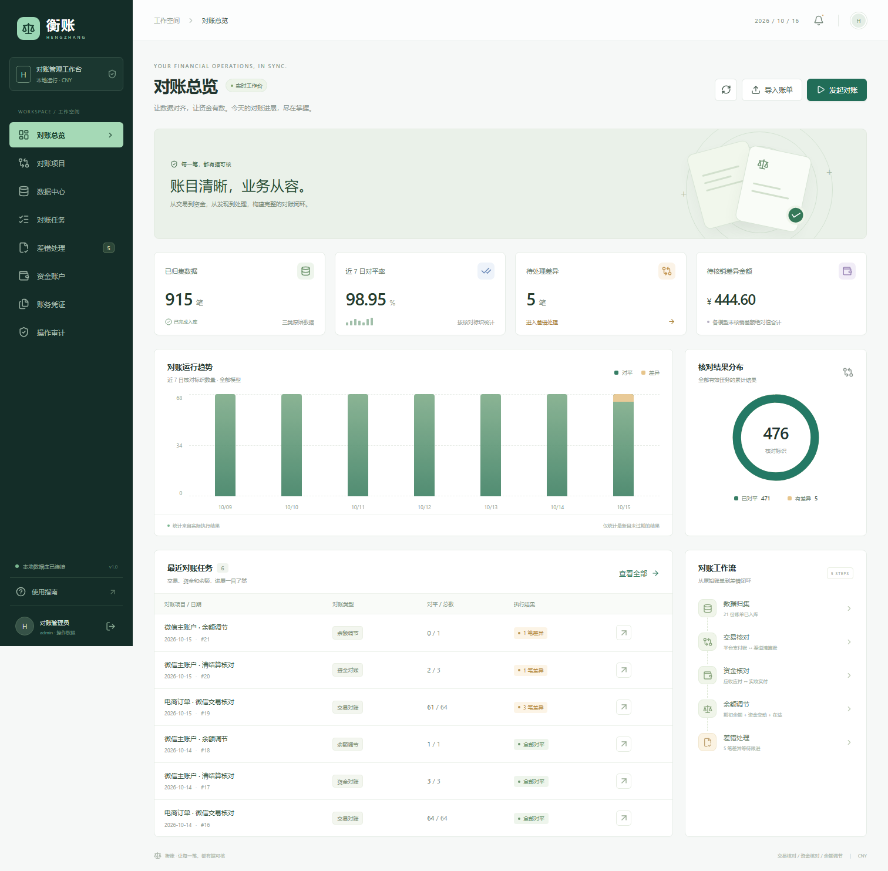

# 衡账 · 对账中心

[](https://github.com/tclear450-max/hengzhang-reconciliation-center/actions/workflows/ci.yml)

[下载可运行交付包](https://github.com/tclear450-max/hengzhang-reconciliation-center/releases/latest) · [系统设计](docs/architecture.md) · [接口文档](docs/api.md)

根据陈天宇宙的[《一文搞懂「对账系统」》](https://mp.weixin.qq.com/s/KJZYmE-F-IYIDR0HjArbgw)独立实现的 Java 项目，包含可操作的 Vue 管理界面、Spring Boot 后端、本地持久化数据库、演示账单和自动化测试。

核心流程：**账户配置 → 账单导入 → 规则配置 → 连续日期对账 → 差异排查 → 核销申请 → 独立复核 → 账务凭证与审计记录**。



## 直接运行

交付包已经包含 `app/reconciliation-center.jar`，运行只需 **Java 21**，无需安装数据库、Node.js 或 Maven。

从 [GitHub Releases](https://github.com/tclear450-max/hengzhang-reconciliation-center/releases/latest) 下载完整 ZIP 并解压后运行。Git 仓库只保存源码、文档和样例；直接克隆源码时，需要先执行 `build.ps1`。

Windows 双击 **`start.bat`**，或在项目目录运行：

```powershell
.\start.ps1
```

打开[本地工作台](http://127.0.0.1:18180)。

| 账号 | 默认密码 | 权限 |
| --- | --- | --- |
| `admin` | `demo123456` | 配置账户和项目、导入、执行对账、排查、提交核销 |
| `reviewer` | `demo123456` | 查看数据、复核通过或驳回核销 |

第一次启动自动生成最近七天的 **915 条原始数据、21 个任务和 5 笔待处理差异**。演示数据仅在数据库完全没有账户时创建，后续重启保留原有业务数据。

```powershell
.\start.ps1 -Port 18182 -NoBrowser  # 自定义端口，不打开浏览器
.\stop.ps1                        # 停止本项目的服务，保留数据
```

数据位于项目下 `data/`，日志位于 `logs/`。服务默认仅监听本机。`stop.ps1` 校验进程命令行，只会停止本项目记录的进程。

## 已实现的功能

| 模块 | 实现内容 |
| --- | --- |
| 对账总览 | 实际数据统计、近七日趋势、结果分布、最近任务、工作流入口 |
| 资金账户 | 商户号、账户编码、启用日期、期初余额；创建后保持期初值 |
| 数据中心 | CSV 与 JSON API 接入；三类源账分开保存；文件与流水幂等；冲突整批回滚；原始明细查询 |
| 交易对账 | 按订单号和业务类型匹配；1:1 和按订单汇总的 1:N / N:N；单边、金额、状态、重复订单检测 |
| 资金对账 | 仅汇总成功流水，按收款、退款、手续费、转账核对应收应付与实收实付；支持 T+N 自然日划付 |
| 余额调节 | 启用余额 + 累计成功流水 + 当前在途调整，比较双方日末余额 |
| 任务控制 | 连续日期、账单就绪校验、重复执行幂等、行锁保护并发、规则快照、版本化重对；晚到数据将旧结果标记为需重对 |
| 差错处理 | 排查、提交核销、独立复核、驳回、分次核销、纯状态差异的零金额处理 |
| 账务凭证 | 差异自动挂账、重对冲销、复核后核销；每份凭证等额登记借贷；按项目隔离挂账账户 |
| 审计与导出 | 操作人、操作对象、内容和时间；差异 CSV 导出；CSV 单元格公式注入防护 |
| 定时执行 | 开启后每分钟检查；按项目时间执行 T+1 与历史补跑；失败写审计；余额调节手动执行 |
| 登录与权限 | Spring Security、BCrypt、HttpOnly 会话 Cookie、CSRF 保护、操作员与复核员分离 |

金额以 **BIGINT 分** 存储，后端用整数和 `BigDecimal` 精确转换，API 将长整数序列化为字符串，前端用 `BigInt` 格式化，避免 JavaScript 金额精度丢失。当前币种为人民币。

## 体验完整流程

1. 用 `admin` 登录，进入“差错处理”，任选一笔差异，填写处理说明和依据，提交核销申请。
2. 退出后用 `reviewer` 登录，打开该笔“待复核”差异，核查依据后通过或驳回。
3. 通过后可在“账务凭证”查看核销凭证，在“操作审计”查看完整记录。部分核销会保留未核销余额。
4. 想从数据导入开始体验，可创建新账户：启用日 `2026-10-15`、期初余额 `1000.00`；依次导入 `samples/2026-10-15/` 的三份文件，分别选择平台、清算、结算数据源。
5. 为新账户创建交易、资金、余额三个项目，起始日设为 `2026-10-15`，资金划付延迟为 `0`，分别执行该日任务。样例期望结果见 [samples/README.md](samples/README.md)。

导入时的账单日期必须和文件中一致。也可以修改样例的所有日期，再调整账户启用日与项目起始日；不能执行未来日期。

## 源码开发与测试

开发环境：**Java 21、Maven 3.9+、Node.js 22.12+（或 20.19+）**。

```powershell
.\build.ps1          # npm ci、类型检查、前端构建、后端测试、打成单个可运行 JAR
.\start.ps1
```

重新构建前先运行 `stop.ps1`，避免 Windows 对运行中 JAR 的文件锁。

前后端分开开发：

```powershell
# 终端一：backend 目录
mvn spring-boot:run

# 终端二：frontend 目录
npm ci
npm run dev
```

开发界面为 `http://127.0.0.1:15173`，Vite 将 `/api` 代理到后端 `18180`。后端工作目录会决定相对路径数据库的位置，开发模式与根目录启动默认使用各自的 `data/`；如需共用，请显式设置绝对 `DB_URL`。

```powershell
# backend 目录：单元与集成测试，使用独立内存数据库
mvn test

# frontend 目录：先确保 backend/target 下存在最新完整 JAR
npx playwright install chromium
npm run test:e2e
```

浏览器测试自动在 **18181** 端口启动独立内存数据库服务并在结束后关闭，不修改本地演示库。已安装 Chromium 的环境也可通过 `PLAYWRIGHT_CHROMIUM_EXECUTABLE_PATH` 指定浏览器路径。图形化测试报告位于 `artifacts/playwright-report/`。

## 配置

Spring Boot 读取进程环境变量，`.env.example` 仅作示例，不会自动加载。

```powershell
$env:ADMIN_PASSWORD = '替换为你的操作员密码'
$env:REVIEWER_PASSWORD = '替换为你的复核员密码'
$env:DEMO_DATA = 'false'           # 新数据库不创建演示数据
$env:SCHEDULING_ENABLED = 'true'   # 同时需要在项目中勾选自动执行
$env:DB_URL = 'jdbc:h2:file:D:/my-data/hengzhang;DB_CLOSE_ON_EXIT=FALSE'
.\start.ps1
```

H2 为默认文件数据库，数据备份时先停止服务，再复制 `data/`。本版 schema 和测试针对 H2，未承诺 MySQL / PostgreSQL 兼容。

## 项目结构

```text
reconciliation-center/
├── app/                       # 可直接运行的完整 JAR（交付包包含）
├── backend/                   # Java / Spring Boot / JDBC / Security
│   └── src/{main,test}/
├── frontend/                  # Vue 3 / TypeScript / Vite / Playwright
├── samples/                   # 标准账单、空账单、JSON 请求样例
├── docs/                      # 设计、接口、验证结果、界面预览
├── scripts/package.py         # 打包源码、JAR、样例和文档，排除本地业务数据
├── build.ps1
├── start.ps1 / start.bat
└── stop.ps1 / stop.bat
```

详细说明：[系统设计](docs/architecture.md) · [API 与接入](docs/api.md) · [验收记录](docs/verification.md)。

## 交付边界

本版完成文章主要对账模型和差错闭环，使用标准 CSV / JSON 连接业务数据。**银行/支付渠道真实账单下载、FTP、MQ、Excel/PDF 解析、短信邮件告警、真实业务补单与退款、外部总账和结算系统尚未接入**；后台不会操作真实资金。

按订单汇总会对同一订单和业务类型的全部明细求和，不做任意子集匹配。资金划付按自然日，不包含节假日日历、分期到账或月度手续费规则。余额在途调整是本次日末存量快照，不自动登记到平台原始账，也不自动结转为下一日新增流水。

项目为单机构、本地部署的完整核心实现。当前没有多租户、SSO、用户管理、分布式队列及大批量流式计算；列表最多最近 500 条，单批最多 10,000 行、5 MB，单次差异导出最多 10,000 条。不同模型的差异金额可能对应同一业务，工作台金额是各项目差额绝对值合计，不能作为企业净损益。
