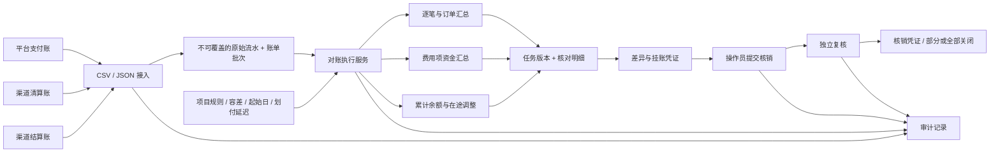
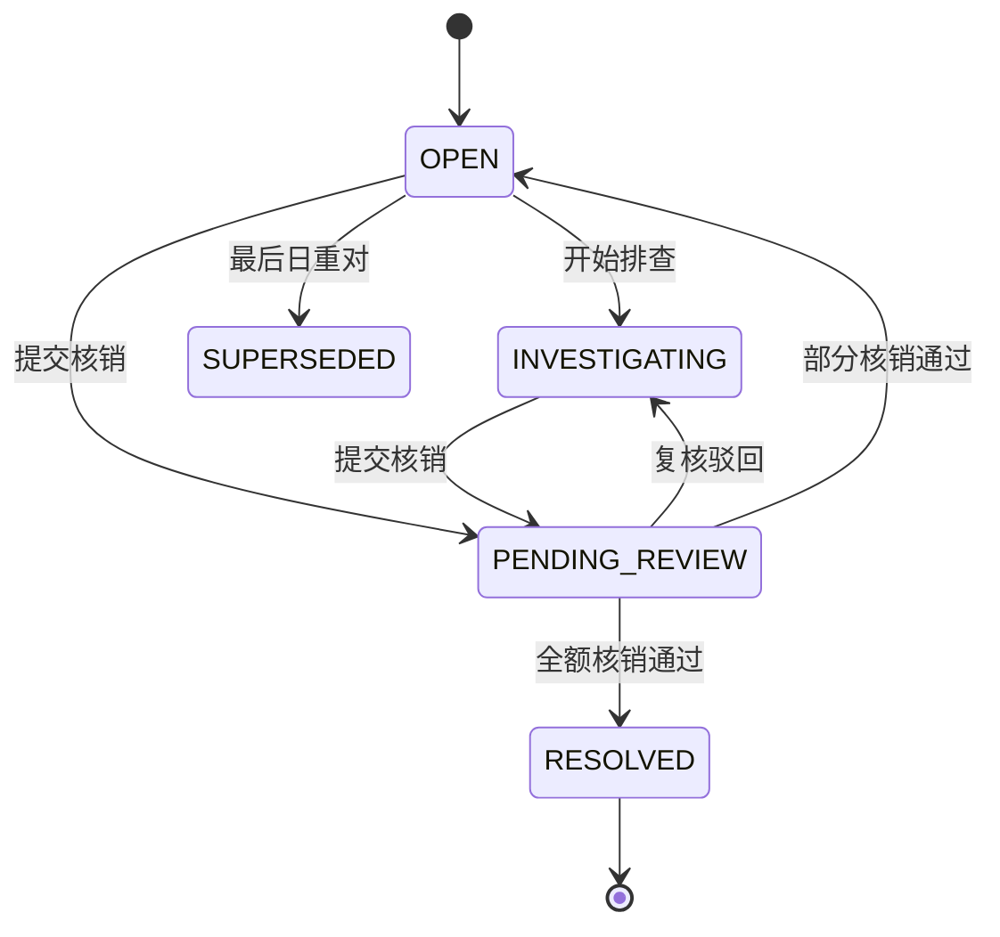

# 系统设计

需求参考：[陈天宇宙《一文搞懂「对账系统」》](https://mp.weixin.qq.com/s/KJZYmE-F-IYIDR0HjArbgw)。本文记录本项目实际实现的设计与边界。

## 模块与数据流

Vue 作为唯一管理入口；Spring Boot 同时提供静态资源和 REST API，生产包只有一个 JAR。后端采用 JDBC 显式事务，纯比较逻辑独立在 `MatchingEngine`，导入、项目配置、任务执行、差异处理与账务登记分别由服务承担。

## 持久化实体

| 表 | 职责与约束 |
| --- | --- |
| `channels` | 资金账户；编码唯一；启用时点期初余额固定 |
| `projects` | 模型、数据源、金额容差、起始/最后日期、调度配置 |
| `import_batches` | 指定账户、来源、日期、规范化内容哈希；也记录明确的零交易账单 |
| `source_records` | 标准化源流水；同账户、同来源下流水号全局唯一；数据冲突拒绝覆盖 |
| `reconciliation_runs` | 项目 + 日期 + 版本唯一；规则快照、汇总、操作人；同日期仅最新版本有效 |
| `reconciliation_items` | 每个匹配键的核对结果，保存双方金额、笔数和说明 |
| `differences` | 非对平结果的处理状态、差额与已核销金额 |
| `resolution_requests` | 核销申请、依据、提交人与复核人、复核结论；不覆盖旧申请 |
| `vouchers` | 同时记录等额借贷；挂账、冲销、核销分别留存；引用事件唯一 |
| `audit_events` | 操作事件、对象、说明、操作人和时间 |

## 关键规则

### 交易对账

匹配键为 `(order_no, business_type)`，防止同订单的收款与退款互相抵消。1:1 下发现任一方多条同键记录，标记重复订单，不能使用覆盖式 Map 消除记录。汇总模式将每侧同键明细全部求和，支持 1:N / N:N 全组核对。

判断顺序：缺 A → 缺 B → 1:1 重复订单 → 状态不一致或组内状态混合 → 金额超过容差 → 对平。双方同状态的失败/处理中记录也参与交易状态核对；资金模型仅统计 SUCCESS。容差仅作用于金额差异，不能掩盖缺单、重复订单或状态差异。

### 资金对账

对账日 `D`：A 方取 `D - settlement_days`，B 方取 `D`，按 `PAYMENT / REFUND / FEE / TRANSFER` 汇总成功流水。金额使用正向收款、负向退款和手续费；转账按资金方向决定正负。输入结算文件需拆成标准费用项，不能仅将轧差净额当作收款。

### 余额调节

`调整后平台余额 = 期初余额 + 启用日起平台成功流水净额 + 平台在途调整`

`调整后渠道余额 = 期初余额 + 启用日起结算成功流水净额 + 渠道在途调整`

双方比较容差。启用日到核对日的每一天、每侧都需要已导入账单；明确的零交易日使用空表头账单。调整为带符号的日末在途存量，只作用于本次快照，不改写原始资金账。累计跨度上限 3,660 天。

## 并发、幂等与重对

- 文件解析在写入前完成；一个事务中校验全部流水，任何冲突都回滚整个批次。
- 导入与执行均先锁定账户行，执行再锁项目，避免对账读取到半个导入批次。
- 重复文件返回原批次，重复流水相同则跳过，内容冲突则拒绝。哈希包含每个字段和字段长度。
- 普通执行同一项目和日期返回原有效任务，不重复创建差异和凭证。
- 首日必须等于项目起始日，其后必须等于最后对账日 + 1；可以连续核对历史日期，不能跳日或核对未来日。
- 重对仅允许最后一个对账日。旧任务和明细永久保留，旧挂账生成反向凭证，旧差异标记 `SUPERSEDED`，新任务增加版本。
- 只要差异开始排查或存在核销申请，便禁止重对，避免丢失处理依据。已存在后续日期的原始数据也禁止补入新流水；最新日且未处理时可补入后重对。
- 晚到新流水会在同一事务内将关联的最后日任务标记为 `stale`，页面显示“需重对”。过期结果排除出统计、差异处理及导出，并阻止后续日期推进。导入与核销均先锁账户，不能同时提交“新账单”和基于旧结果的核销。
- 复核锁定差异和待复核申请，同一请求只能处理一次。任何账务或审计写入失败，业务变更一并回滚。

## 差异状态机

申请金额不能超过剩余未核销金额。纯状态/重复订单差异的金额可能为零，可提交 0 元处理并独立复核，不制造零金额账务凭证。

## 账务与安全边界

挂账按 `SUSPENSE:P<projectId>` 隔离，各模型是独立对账子账，不能相加当作企业总账。正差额挂账借记挂账账户、贷记对账过渡账户；负差额反向记。重对交换原凭证借贷。核销通过后用等额反向分录冲减挂账，核销对方科目由处理类型决定。所有凭证同时保存借贷账户与同一金额，借贷平衡由结构保证。

这里的凭证是本地对账业务记录。真实账务系统、科目制度、审批制度、付款权限及业务补单仍需要具体机构接入。

账户使用 BCrypt；会话由服务端管理，Cookie 为 HttpOnly / SameSite=Strict；CSRF 令牌从 `/api/session` 获取并以 `X-XSRF-TOKEN` 传回。操作员与复核员的写入接口分别校验权限，服务还拒绝提交人自审。长整数通过 JSON 字符串传输，避免浏览器的 IEEE-754 精度损失。

## 与结算系统的关系

本项目不发起结算。外部系统可以查询任务与差异结果，基于业务截止时间决定继续等待、使用已核对结果，或走原有结算策略；不应将此演示服务的可用性直接作为真实商户付款前提。结算超时策略、节假日划付规则、渠道适配及补单接口是下一阶段接入内容。
